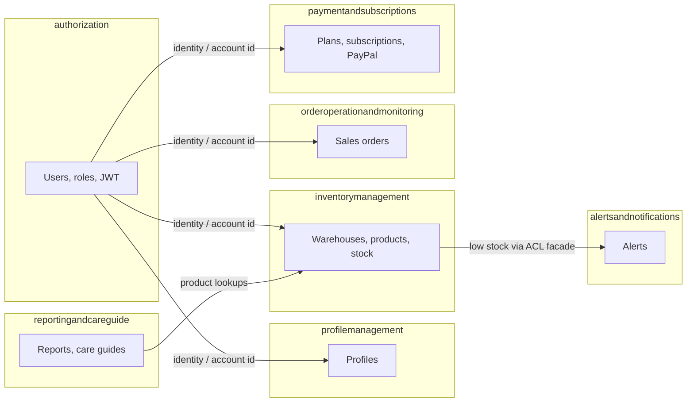

<div align="center">

# 🍷 WineInventory — Back-End API

**REST API for liquor producers and distributors to manage warehouses, stock, sales orders, care guides and subscription plans.**

> 🇪🇸 *API REST para productores y distribuidores de licores: almacenes, stock, pedidos de venta, guías de cuidado y planes de suscripción con PayPal.*

[](https://github.com/wineinventory-Hub/wineinventory-backend/actions/workflows/ci.yml)


</div>

---

## Table of contents

- [Overview](#overview)
- [Key features](#key-features)
- [Tech stack](#tech-stack)
- [Architecture](#architecture)
- [Security](#security)
- [API overview](#api-overview)
- [Getting started](#getting-started)
- [Environment variables](#environment-variables)
- [Running the tests](#running-the-tests)
- [Deployment](#deployment)
- [Project structure](#project-structure)
- [Credits](#credits)

## Overview

WineInventory helps liquor **producers** keep track of their products across several warehouses and lets **distributors** place orders with them. The API covers the whole flow: sign-up and JWT sign-in, warehouse and product management (with images on Cloudinary), stock movements with best-before dates, low-stock alerts, sales orders, reports, care guides and paid subscription plans through PayPal.

The code follows **Domain-Driven Design**: every business area is an isolated bounded context with its own domain, application, infrastructure and interface layers.

## Key features

- 🔐 **JWT authentication** with BCrypt password hashing and two roles: `PRODUCER` and `DISTRIBUTOR`.
- 🛡️ **Resource ownership checks**: a user can only read or change its own accounts, warehouses, products, alerts, care guides and orders.
- 🏭 **Multi-warehouse inventory**: add, reduce and move stock between warehouses, tracking each batch by best-before date.
- 🔔 **Alerts**: low-stock alerts published from the inventory context through an anti-corruption facade.
- 🧾 **Sales orders**: distributors create orders, producers update their status, complete or delete them.
- 📊 **Reports and care guides**: sales/loss reports and storage guides that can be linked to products.
- 💳 **Subscriptions with PayPal**: plans, subscription checkout, return/cancel callbacks and webhook validation.
- 🖼️ **Image uploads** to Cloudinary for products and warehouses.
- ❗ **Consistent errors** using RFC 7807 Problem Details (`application/problem+json`).
- 📘 **OpenAPI / Swagger UI** documentation with bearer-token support.
- 🐳 **Docker and docker compose**, a public health check and GitHub Actions CI.

## Tech stack

| Layer | Technology |
|---|---|
| Language | Java 21 (LTS) |
| Framework | Spring Boot 3.5 (Web, Data JPA, Validation, Security, Actuator) |
| Database | MySQL 8 (H2 in MySQL mode for tests) |
| Auth | Spring Security, JJWT 0.12, BCrypt |
| Integrations | PayPal REST API, Cloudinary |
| Docs | springdoc-openapi 2.8 (Swagger UI) |
| Build | Maven (wrapper included), Lombok |
| DevOps | Docker multi-stage image, docker compose, GitHub Actions |

## Architecture

Each bounded context lives in its own package and follows the same four layers:

| Layer | Responsibility |
|---|---|
| `domain` | Aggregates, entities, value objects, commands, queries and domain service interfaces |
| `application` | Command and query service implementations, ACL facades, outbound services |
| `infrastructure` | JPA repositories, security, JWT, Cloudinary and PayPal adapters |
| `interfaces` | REST controllers, resources (DTOs) and assemblers, ACL entry points |



`shared` contains cross-cutting pieces: the base aggregate, the JPA naming strategy (snake_case, pluralized tables), OpenAPI configuration and the global exception handler. Architecture models are in [`docs/`](docs) (C4 model in Structurizr DSL and a PlantUML class diagram).

## Security

- **Authentication**: `POST /api/v1/sign-in` returns a JWT. Send it as `Authorization: Bearer <token>` on every other request.
- **Public endpoints**: sign-in, sign-up, Swagger/OpenAPI, `GET /actuator/health`, the PayPal return/cancel callbacks and the subscription webhook.
- **Roles**
  - `PRODUCER`: manages warehouses, products and stock, creates and edits care guides, updates, completes and deletes sales orders.
  - `DISTRIBUTOR`: creates sales orders for its own account and can only see its own orders.
- **Ownership**: method security (`@PreAuthorize`) calls a `ResourceOwnershipGuard` that checks the resource belongs to the signed-in account. Wrong account → `403 Forbidden`.
- **Errors**: `401`, `403`, `404`, `409`, `400` (with field errors) and `500` are returned as Problem Details. Internal error details are never exposed.
- **Configuration**: no secrets live in the repository. Everything is read from environment variables (see [`.env.example`](.env.example)).

## API overview

Full interactive documentation: **`/swagger-ui.html`** (OpenAPI JSON at `/v3/api-docs`).

<details open>
<summary><b>Authentication and profile</b></summary>

| Method | Path | Access |
|---|---|---|
| POST | `/api/v1/sign-up` | Public |
| POST | `/api/v1/sign-in` | Public |
| GET | `/api/v1/profile` | Authenticated (own profile) |
| PUT | `/api/v1/profile` | Authenticated (own profile) |

</details>

<details>
<summary><b>Inventory management</b></summary>

| Method | Path | Access |
|---|---|---|
| POST | `/api/v1/accounts/{accountId}/warehouses` | Account owner (multipart, with image) |
| GET | `/api/v1/accounts/{accountId}/warehouses` | Account owner |
| GET | `/api/v1/warehouses` | Authenticated |
| GET / PUT / DELETE | `/api/v1/warehouses/{warehouseId}` | Warehouse owner |
| POST | `/api/v1/accounts/{accountId}/products` | Account owner (multipart, with image) |
| GET | `/api/v1/accounts/{accountId}/products` | Account owner |
| GET / PUT / DELETE | `/api/v1/products/{productId}` | Product owner |
| GET | `/api/v1/warehouses/{warehouseId}/inventories` | Warehouse owner |
| POST / DELETE | `/api/v1/warehouses/{warehouseId}/inventories/products/{productId}` | Warehouse and product owner |
| PUT | `.../inventories/products/{productId}/additions` | Warehouse and product owner |
| PUT | `.../inventories/products/{productId}/substractions` | Warehouse and product owner |
| PUT | `.../inventories/products/{productId}/moves` | Owner of both warehouses and the product |
| GET | `.../inventories/products/{productId}/expiration-date/{date}` | Warehouse and product owner |

</details>

<details>
<summary><b>Sales orders</b></summary>

| Method | Path | Access |
|---|---|---|
| POST | `/api/v1/orders` | `DISTRIBUTOR`, buyer must be its own account |
| GET | `/api/v1/orders` | Authenticated |
| GET | `/api/v1/orders/{orderId}` | Producer, or the distributor that owns the order |
| PATCH | `/api/v1/orders` | `PRODUCER` (update status) |
| PATCH | `/api/v1/orders/{orderId}/complete` | `PRODUCER` |
| DELETE | `/api/v1/orders/{orderId}` | `PRODUCER` |

</details>

<details>
<summary><b>Reports and care guides</b></summary>

| Method | Path | Access |
|---|---|---|
| GET / POST | `/api/v1/reports` | Authenticated |
| GET / DELETE | `/api/v1/reports/{id}` | Authenticated |
| GET | `/api/v1/accounts/{accountId}/care-guides` | Account owner |
| GET | `/api/v1/accounts/{accountId}/care-guides/{careGuideId}` | Account and care guide owner |
| POST | `/api/v1/accounts/{accountId}/care-guides` | `PRODUCER`, account owner |
| POST | `/api/v1/accounts/{accountId}/care-guides/products/{productId}` | `PRODUCER`, account and product owner |
| GET | `/api/v1/careguides/{careGuideId}` | Care guide owner |
| PUT / DELETE | `/api/v1/careguides/{careGuideId}` | `PRODUCER`, care guide owner |
| PUT | `/api/v1/careguides/{careGuideId}/allocations/{productId}` | `PRODUCER`, care guide and product owner |
| PUT | `/api/v1/careguides/{careGuideId}/deallocations` | `PRODUCER`, care guide owner |

</details>

<details>
<summary><b>Alerts</b></summary>

| Method | Path | Access |
|---|---|---|
| GET | `/api/v1/accounts/{accountId}/alerts` | Account owner |
| GET | `/api/v1/alerts/{alertId}` | Alert owner |

</details>

<details>
<summary><b>Plans and subscriptions</b></summary>

| Method | Path | Access |
|---|---|---|
| GET | `/api/v1/plans` | Authenticated |
| PATCH | `/api/v1/plans/{planId}/paypal-plan` | Authenticated |
| POST | `/api/v1/accounts/{accountId}/subscriptions` | Account owner |
| GET | `/api/v1/accounts/{accountId}/subscriptions` | Account owner |
| PUT | `/api/v1/accounts/{accountId}/subscriptions/{subscriptionId}` | Account owner (upgrade) |
| POST | `/api/v1/subscriptions` | Public (PayPal webhook) |
| GET | `/api/v1/subscriptions/paypal/return` · `/paypal/cancel` | Public (PayPal redirects) |

</details>

<details>
<summary><b>Operations</b></summary>

| Method | Path | Access |
|---|---|---|
| GET | `/actuator/health` | Public |

</details>

## Getting started

### Option 1 — Docker (recommended)

Requirements: Docker with the compose plugin.

```bash
git clone https://github.com/wineinventory-Hub/wineinventory-backend.git
cd wineinventory-backend
cp .env.example .env          # set DATABASE_PASSWORD and JWT_SECRET at least
docker compose up --build
```

The API starts on `http://localhost:8080` together with a MySQL 8.4 container (data is kept in the `mysql-data` volume).

- Swagger UI: http://localhost:8080/swagger-ui.html
- Health: http://localhost:8080/actuator/health

### Option 2 — Local Java

Requirements: JDK 21 and a running MySQL 8 server.

```bash
cp .env.example .env          # point DATABASE_URL to your MySQL server
# load the variables in your shell (or use your IDE's EnvFile support), then:
./mvnw spring-boot:run        # Windows: mvnw.cmd spring-boot:run
```

Tables are created automatically by Hibernate on the first start (`ddl-auto=update`). With the default `dev` profile the database `wineinventory` is created if it does not exist.

## Environment variables

| Variable | Required | Description |
|---|---|---|
| `SPRING_PROFILES_ACTIVE` | No | `dev` (default) or `prod`. `prod` requires every database and CORS variable |
| `PORT` | No | HTTP port, `8080` by default (set automatically by most cloud platforms) |
| `DATABASE_URL` | Yes in prod | JDBC URL, e.g. `jdbc:mysql://host:3306/wineinventory?useSSL=true` |
| `DATABASE_USER` / `DATABASE_PASSWORD` | Yes in prod | Database credentials |
| `JWT_SECRET` | **Yes** | HMAC secret, at least 32 characters (`openssl rand -base64 48`) |
| `JWT_EXPIRATION_DAYS` | No | Token lifetime in days, `7` by default |
| `CLOUDINARY_CLOUD_NAME` / `CLOUDINARY_API_KEY` / `CLOUDINARY_API_SECRET` | For image uploads | Cloudinary credentials |
| `FRONTEND_URL` | No | Front-end base URL, used for redirects |
| `CORS_ALLOWED_ORIGINS` | Yes in prod | Comma separated list of allowed origins |
| `PAYPAL_CLIENT_ID` / `PAYPAL_CLIENT_SECRET` | For payments | PayPal REST app credentials |
| `PAYPAL_API_BASE_URL` | No | Sandbox by default, `https://api-m.paypal.com` for live |
| `PAYPAL_WEBHOOK_ID` | For webhooks | Webhook id used to validate PayPal events |
| `PAYPAL_RETURN_URL` / `PAYPAL_CANCEL_URL` | No | Public URLs of the return/cancel callbacks |

## Running the tests

```bash
./mvnw verify
```

Tests run on an in-memory H2 database, so no MySQL or external service is needed. Besides the context test, `SecurityIntegrationTests` checks the public health endpoint, `401` without a token, wrong credentials, and that ownership and role rules answer `403`. The same command runs on every push and pull request through GitHub Actions.

## Deployment

The repository ships a production-ready multi-stage `Dockerfile` (Temurin 21 JRE, non-root user, health check). Any platform that builds Dockerfiles can run it.

### Railway

1. **New project → Deploy from GitHub repo** and select this repository. Railway detects the `Dockerfile`.
2. **Add a MySQL database** to the project.
3. In the API service, set the variables:
   - `SPRING_PROFILES_ACTIVE=prod`
   - `DATABASE_URL=jdbc:mysql://${{MySQL.MYSQLHOST}}:${{MySQL.MYSQLPORT}}/${{MySQL.MYSQLDATABASE}}`
   - `DATABASE_USER=${{MySQL.MYSQLUSER}}` and `DATABASE_PASSWORD=${{MySQL.MYSQLPASSWORD}}`
   - `JWT_SECRET`, `CORS_ALLOWED_ORIGINS` (your front-end URL), and the Cloudinary / PayPal values you use
4. Set the **health check path** to `/actuator/health` and generate a public domain.
5. Update `PAYPAL_RETURN_URL` / `PAYPAL_CANCEL_URL` with that domain and register the webhook in PayPal pointing to `https://<domain>/api/v1/subscriptions`.

### Render

Create a **Web Service** from the repository with the **Docker** runtime, use an external MySQL (for example Aiven or Railway MySQL), set the same variables and use `/actuator/health` as the health check path. `PORT` is injected automatically.

## Project structure

```text
wineinventory-backend
├── .github/workflows/ci.yml        # build, test and Docker image on every push / PR
├── docs/                           # C4 model (Structurizr DSL) and class diagram (PlantUML)
├── src/main/java/com/wineinventory
│   ├── authorization/              # users, roles, JWT, Spring Security, ownership guard
│   ├── profilemanagement/          # user profiles
│   ├── inventorymanagement/        # warehouses, products, stock, Cloudinary
│   ├── orderoperationandmonitoring/# sales orders
│   ├── reportingandcareguide/      # reports and care guides
│   ├── alertsandnotifications/     # stock alerts
│   ├── paymentandsubscriptions/    # plans, subscriptions, PayPal
│   └── shared/                     # base classes, naming strategy, OpenAPI, error handling
├── src/main/resources/             # application.properties + dev / prod profiles
├── src/test/                       # H2 test configuration and integration tests
├── Dockerfile
├── docker-compose.yml
├── .env.example
└── pom.xml
```

## Credits

WineInventory started in 2025 as a team academic project at UPC (Universidad Peruana de Ciencias Aplicadas), built by the StockVin team.

This version was extended by **Giovany Torres** ([@giovanydevv](https://github.com/giovanydevv)) with Java 21, role-based access and resource ownership checks, environment-based configuration, RFC 7807 error handling, integration tests, Docker and CI/CD, and deployment documentation.
